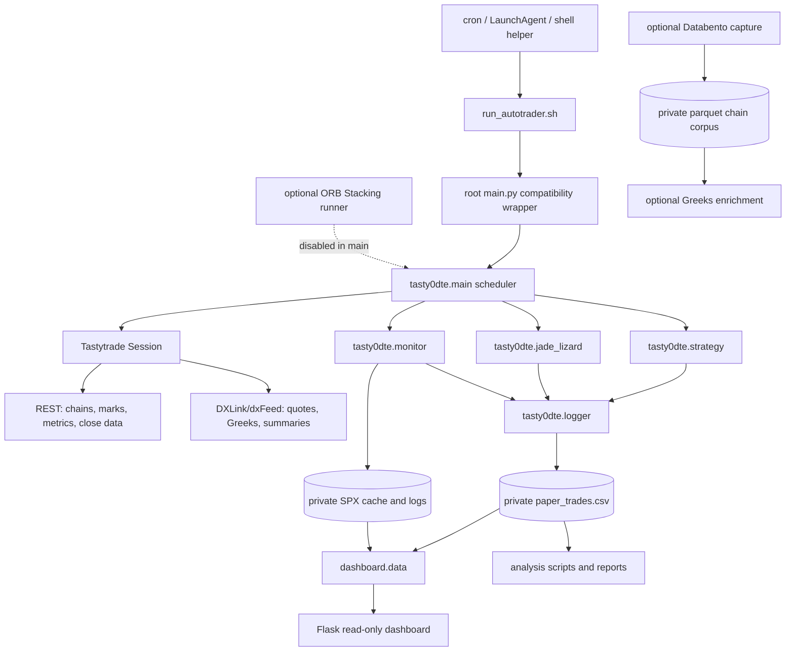

# Architecture

This document describes the implemented system at repository level. It follows imports and calls in the source rather than assuming that every filename or historical document is current.

## System shape

The application is a macOS-oriented, long-running Python process. It has no database, queue, or separate API server in the core trading loop. A single bot process owns one Tastytrade session, reads market data, writes a shared CSV ledger, and repeatedly monitors that ledger.



The core dependency direction is:

```text
launch helpers
  -> root compatibility wrappers
    -> tasty0dte runtime
      -> project_paths + Tastytrade SDK + optional local notifications
        -> private CSV/log/state files
          -> dashboard, analysis, and manual tools
```

The dashboard and analysis code read the runtime outputs. They are not upstream of strategy selection.

## Components and boundaries

### Runtime coordinator: `tasty0dte/main.py`

`main()` loads credentials, creates one `tastytrade.Session`, and loops in `Europe/London` time. It checks two trigger times, prevents duplicate triggers within the same day, launches a trade cycle, then calls the monitor approximately every 10 seconds.

`execute_trade_cycle()` has two stages:

1. It runs each active Jade Lizard variant independently.
2. It fetches one shared SPX chain and then processes eligible 0DTE configurations independently.

The chain fetch and per-strategy validation have retry logic. A strategy exception is logged and skipped so that later strategies can still run. The disabled ORB launch is still imported, but its `asyncio.create_task(run_orb_stacking(...))` block is commented out in the current main loop.

### Market-data and leg selection: `tasty0dte/strategy.py`

This module is the adapter between the runtime and the Tastytrade SDK:

- `fetch_spx_option_chain()` gets the option chain.
- `filter_for_0dte()` selects today's expiry.
- `fetch_spx_iv_rank()` gets SPX IV rank from market metrics.
- `get_spx_spot()` uses DXLink Quote data and then Trade data as a fallback.
- `get_greeks_for_chain()` streams Greeks for the candidate expiry.
- `find_iron_fly_legs()` and `find_iron_condor_legs()` choose strikes from delta and width rules.
- `_fetch_leg_prices()` uses REST marks for the selected legs.
- `get_spx_close()` uses REST, then dxFeed Summary, then the cached SPX price for EOD settlement.
- `validate_credit_sanity()` applies the no-arbitrage credit limit and ATM put-call-parity check.

The module contains both REST-style and streaming data paths because the project uses reliable REST marks for entry validation and live DXLink events for fast monitoring.

### Multi-day strategy: `tasty0dte/jade_lizard.py`

`execute_jade_lizard()` checks whether that exact variant already has an open CSV row, fetches SPX spot and the chain, selects the first expiry at or beyond the target DTE, calculates an expected move from market IV, and chooses:

- a short put and a put wing 20 points below it;
- a short call and a call wing 5 points above it.

It nudges the short strikes closer to the money when the calculated credit is below its floor, validates the final credit, records the target expiry in `Notes`, and appends an `OPEN` row. The monitor later uses that note to avoid settling the position on the wrong day.

### Persistence: `tasty0dte/logger.py` and `project_paths.py`

`project_paths.py` resolves the private root and all file paths from `TASTY_PRIVATE_DATA_ROOT` plus optional per-file overrides. `logger.py` owns the CSV header, creates missing files, migrates older headers, and appends entries or ORB skip events.

The paper ledger is not an append-only event store: the monitor reads it into pandas, updates status/exit fields, and writes the CSV back. This makes the column names, status values, and numeric formats a shared contract.

### Position monitor: `tasty0dte/monitor.py`

`check_open_positions()` reads open rows, subscribes to DXLink `Quote` events for the leg symbols, calculates a debit-to-close and P/L, and applies profit-target, stop-loss, and time-exit rules. It has quote-sanity and multi-day hold / two-sided-quote guards to avoid closing on impossible or one-sided prices.

`check_eod_expiration()` runs after the UK close threshold, calculates intrinsic settlement for each leg, writes `EXPIRED` and `Exit P/L`, and records the settlement price in `Notes`. Jade Lizard rows skip same-day settlement and are settled only when the `target_expiry` in their notes matches the current date; their profit-target path can close them earlier after the multi-day hold and two-sided-quote guards pass.

### Dashboard: `dashboard/app.py`, `dashboard/data.py`, and templates

The Flask dashboard is a read-only presentation layer. Routes render pages and HTMX partials for market state, open positions, today's closed trades, performance, strategy display, system health, and PDT tracking. `/api/chart-data` returns chart data as JSON.

`dashboard.data` reads the CSV, PID file, cached SPX price, cron log, trade log, and stderr log. It uses `os.kill(pid, 0)` only to check whether the PID exists; it does not send a trading command. The default bind is loopback (`127.0.0.1:5050`); `DASHBOARD_HOST` can expose it more broadly, so that setting needs deliberate review.

`dashboard/config.py` is a separate display configuration rather than an import of `tasty0dte.main.STRATEGY_CONFIGS`. It currently contains retired strategies and old times. The runtime configuration in `tasty0dte/main.py` is authoritative.

### Analysis and manual tools

The `analysis/` scripts read the paper ledger through shared filters in `analysis/common.py` and produce reports, dashboards, or public-site data. `tools/` contains one-off probes, backtests, ledger viewers, operational helpers, and the chain-capture pipeline. These tools are not all read-only: inspect a tool before running it, especially anything named `settle`, `patch`, `cleanup`, `capture`, or `live_tracker`.

## Main data flows

### 1. 0DTE Iron Fly entry

```text
scheduled trigger
  -> fetch SPX chain
  -> select today's expiry
  -> fetch IV rank + SPX spot
  -> stream Greeks for candidate options
  -> choose ATM call/put and wings
  -> REST-fetch leg marks
  -> calculate credit and buying power
  -> validate credit sanity
  -> append OPEN row to paper_trades.csv
  -> optional Discord/X notification
```

If the shared chain is unavailable, the 0DTE stage ends for that cycle. If one strategy fails validation or raises an exception, that strategy is skipped and the loop continues.

### 2. Jade Lizard entry

```text
scheduled trigger
  -> check exact variant has no OPEN row
  -> fetch SPX spot and full chain
  -> choose target expiry (5/7/10 DTE variant)
  -> fetch expiry IV and calculate expected move
  -> choose four strikes, nudging toward ATM if needed
  -> REST-fetch marks and compute credit
  -> enforce credit floor + sanity guard
  -> append OPEN row with target_expiry note
```

This path deliberately runs before the shared 0DTE chain stage because it has its own chain/expiry needs and should not be lost merely because the 0DTE fetch fails.

### 3. Monitoring and exit

```text
every ~10 seconds
  -> read OPEN rows
  -> subscribe to leg quotes
  -> calculate debit-to-close and paper P/L
  -> reject stale/impossible quote results
  -> close eligible rows or leave them OPEN
  -> write updated CSV + optional close notification
```

At EOD, the monitor switches from quote-based exit logic to intrinsic settlement for eligible positions.

### 4. Dashboard and analysis

```text
private CSV/log/state files
  -> dashboard.data / analysis.common
  -> dashboard pages, chart JSON, reports, and generated site data
```

Neither path feeds decisions back into the core scheduler. The exception is manual/operator tooling that may deliberately edit or patch records; those tools need separate review.

### 5. Optional historical chain corpus

```text
DATABENTO_API_KEY
  -> tools/capture_spx_chain.py
  -> private parquet NBBO files
  -> tools/enrich_chain_greeks.py
  -> private parquet files with IV and Black-76 Greeks
```

The daily shell wrapper is idempotent with `--skip-existing`, but confirmed Databento downloads consume the external account's data allowance. This workflow is separate from the live paper-trading loop.

## External services and dependencies

| Service/dependency | Used for | Where connected |
|---|---|---|
| Tastytrade SDK | Session/authentication, option chains, market data, metrics | `tasty0dte/strategy.py`, `tasty0dte/jade_lizard.py`, `tasty0dte/monitor.py` |
| Tastytrade DXLink/dxFeed | SPX quotes, trades, Greeks, summaries, and optional candles | runtime modules and `orb_stacking/bar_fetcher.py` |
| Discord webhooks | Optional trade-open, close, and skip notifications | `local/discord_notify.py` and guarded runtime calls |
| Optional X/Twitter script | Optional post after a Discord notification | `TWEET_SCRIPT_PATH` in `local/discord_notify.py` |
| Databento OPRA | Optional historical 1-minute option NBBO capture | `tools/capture_spx_chain.py` |
| yfinance | Centres optional chain captures on an SPX close | `tools/capture_spx_chain.py` |
| Flask + pandas | Local dashboard and CSV-based metrics | `dashboard/` |

The base dependency list is in `requirements.txt`. The optional capture/enrichment packages are checked at runtime by the tools rather than all being declared there.

## Runtime and deployment shape

- Foreground operation goes through `run_autotrader.sh`, which activates `venv`, uses macOS `caffeinate`, and runs `python -u main.py`.
- Background operation uses `start.sh`, `status.sh`, and `stop.sh`, with PID and logs under the private root.
- `cron_start.sh` and `cron_stop.sh` provide scheduled start/stop helpers. `market_session_guard.sh` is a separate API-based watchdog and is observe-only unless its enable marker or a force flag is used.
- `com.example.tasty0dte.plist` describes a macOS LaunchAgent and contains machine-specific absolute paths. `setup_service.sh` generates/installs a LaunchAgent, so it is an operational mutation and should not be run casually.
- The dashboard is a separate Flask process. It defaults to local-only binding but can be configured through `DASHBOARD_HOST`.

No committed CI pipeline, package build, database migration system, or production deployment target was found in the repository. The project is intentionally script-centric.

## Architectural constraints and risks

1. **Paper-only safety is a boundary, not a feature flag.** The current runtime has no order-submission call. Adding one would materially change the system and needs explicit approval and new safeguards.
2. **The CSV is shared mutable state.** Runtime, monitor, dashboard, analysis, and tests all depend on its paths and schema. A migration or path change must be tested across all consumers.
3. **Time configuration is duplicated.** `main.py`, `dashboard/config.py`, shell schedules, and ORB time utilities can disagree. DST changes are particularly dangerous because US and UK clocks change on different dates.
4. **Streaming and REST are intentionally mixed.** Entry uses REST marks because they are easier to validate; monitoring uses DXLink because it needs continuing quote updates. Changing one to the other changes timing and failure behaviour.
5. **The notifier is optional and asynchronous.** Discord/X failures should not stop trade selection, but they can make skips or exits less visible.
6. **Tests can interact with file logging.** Run them with the bot stopped, or isolate the private data root when the environment requires it.
7. **Historical docs contain drift.** `README.md` still includes older strategy times and repository-local data paths. Use the code and `project_paths.py` as the source of truth until those sections are refreshed.
